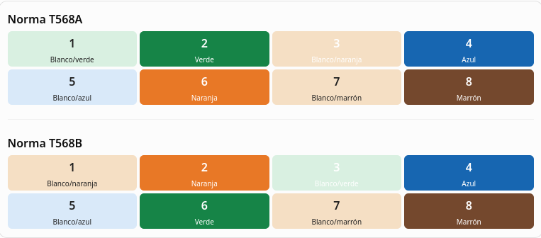

# El par trenzado

Redes Locales · Grado Medio de Sistemas Microinformáticos y Redes (SMR)

## 1. ¿Qué es el par trenzado?

El par trenzado es un tipo de cable utilizado para transmitir datos entre dispositivos de una red informática, como ordenadores, switches, routers o puntos de acceso.

Está formado por varios pares de hilos de cobre. Los dos hilos de cada par están enrollados entre sí formando una especie de trenza.

7

El trenzado de los hilos sirve para reducir las interferencias electromagnéticas que pueden afectar a la transmisión de datos.

Por ejemplo, cuando conectamos un ordenador a un switch mediante un cable Ethernet, normalmente estamos utilizando un cable de par trenzado.

## 2. Características principales

- Medio de transmisión: utiliza señales eléctricas que viajan por hilos de cobre.
- Tipo de transmisión: permite enviar y recibir datos entre dispositivos de red.
- Conector habitual: RJ45, conocido técnicamente como 8P8C.
- Longitud habitual: hasta 100 metros para un canal Ethernet convencional, incluyendo los latiguillos.
- Ventajas: es económico, flexible, fácil de instalar y mantener.
- Inconvenientes: puede verse afectado por interferencias y tiene una distancia limitada.

## 3. Tipos de par trenzado

Los cables de par trenzado se clasifican según el apantallamiento que incorporan para proteger los hilos frente a las interferencias.

UTP (Unshielded Twisted Pair)

No tiene una pantalla metálica adicional. Es el más habitual en las instalaciones de redes locales por su bajo coste y facilidad de instalación.

FTP (Foiled Twisted Pair)

Incorpora una lámina metálica que rodea los pares para mejorar la protección frente a interferencias.

STP (Shielded Twisted Pair)

Se utiliza como denominación general para cables apantallados. Según el diseño, la pantalla puede proteger los pares individualmente o al conjunto.

Importante: los cables apantallados deben instalarse correctamente y con los componentes adecuados para aprovechar su protección. No basta con que el cable tenga una pantalla metálica.

## 4. Categorías del cable

Las categorías indican las prestaciones del cable, como el ancho de banda y su capacidad para transmitir datos a distintas velocidades.

| Categoría | Ancho de banda | Uso habitual                                                                          |
| --------- | -------------- | ------------------------------------------------------------------------------------- |
| Cat 5e    | 100 MHz        | Gigabit Ethernet (1 Gbps)                                                             |
| Cat 6     | 250 MHz        | Redes de 1 Gbps y 10 Gbps en determinadas condiciones                                 |
| Cat 6A    | 500 MHz        | Redes de 10 Gbps hasta 100 metros                                                     |
| Cat 7     | 600 MHz        | Cableado apantallado de mayores prestaciones                                          |
| Cat 8     | 2000 MHz       | Conexiones de alta velocidad en centros de datos, hasta 30 metros según la aplicación |

Nota: los MHz indican el ancho de banda del cable, no la velocidad de transmisión en Gbps. La velocidad efectiva depende también de los equipos, la longitud y la instalación.

## 5. ¿Qué es el conector RJ45?

El conector utilizado habitualmente en los cables Ethernet de par trenzado tiene ocho posiciones y ocho contactos, por lo que técnicamente se denomina 8P8C. Popularmente se conoce como RJ45.

4

Este conector permite unir el cable a una tarjeta de red, un switch, un router o una roseta de red.

Para fabricar un cable se utiliza una herramienta llamada crimpadora, que fija el conector a los conductores del cable.

### Normas de cableado T568A y T568B

Existen dos normas principales que establecen el orden de los ocho hilos dentro del conector.

Las dos normas son válidas. Lo importante es respetar el orden de los hilos y utilizar un criterio coherente en la instalación.

- Cable directo: utiliza la misma norma en ambos extremos, por ejemplo, T568B-T568B. Es el más habitual para conectar un ordenador a un switch.
- Cable cruzado: utiliza T568A en un extremo y T568B en el otro. Tradicionalmente se empleaba para conectar dispositivos similares; hoy muchos equipos admiten detección automática del cruce.

## 6. ¿Cómo funciona el trenzado?

Cuando una señal eléctrica circula por un cable, puede generar interferencias que afectan a otros conductores cercanos. También puede recibir interferencias de fuentes externas.

Al trenzar los dos hilos de cada par:

1. Se reduce la influencia de las interferencias externas.
2. Se disminuye la interferencia entre pares, conocida como diafonía.
3. Se mejora la calidad de la señal y la fiabilidad de la comunicación.

Por eso, no debemos deshacer innecesariamente el trenzado al instalar un conector. Hay que mantener los hilos trenzados lo máximo posible hasta los contactos.

## 7. Instalación de una red con par trenzado

Una instalación típica de red local puede seguir este recorrido:

1. El ordenador se conecta mediante un cable Ethernet a una roseta de red.
2. La roseta se conecta mediante cableado horizontal al panel de parcheo.
3. El panel de parcheo se conecta a un switch mediante latiguillos.
4. El switch permite la comunicación con otros equipos de la red y, si corresponde, con el router.

En instalaciones estructuradas, el enlace permanente de cableado suele tener un máximo de 90 metros. Con los latiguillos, el canal completo convencional puede alcanzar los 100 metros.

## 8. Ventajas e inconvenientes

| Ventajas                         | Inconvenientes                                                |
| -------------------------------- | ------------------------------------------------------------- |
| Precio económico.                | Distancia limitada.                                           |
| Fácil instalación.               | Puede sufrir interferencias.                                  |
| Flexible y sencillo de mantener. | El cable de cobre puede dañarse físicamente.                  |
| Adecuado para redes Ethernet.    | Los modelos apantallados requieren una instalación apropiada. |

## 9. Resumen

- El par trenzado transmite datos mediante señales eléctricas por hilos de cobre.
- Cada par está formado por dos hilos enrollados entre sí para reducir interferencias.
- UTP es el tipo sin pantalla metálica; FTP y STP hacen referencia a soluciones apantalladas, con diferencias según su construcción.
- Las categorías Cat 5e, Cat 6 y Cat 6A ofrecen distintas prestaciones.
- El conector Ethernet habitual es el 8P8C, conocido como RJ45.
- Las normas T568A y T568B establecen el orden de los hilos.
- La longitud máxima habitual de un canal Ethernet de par trenzado es de 100 metros.

